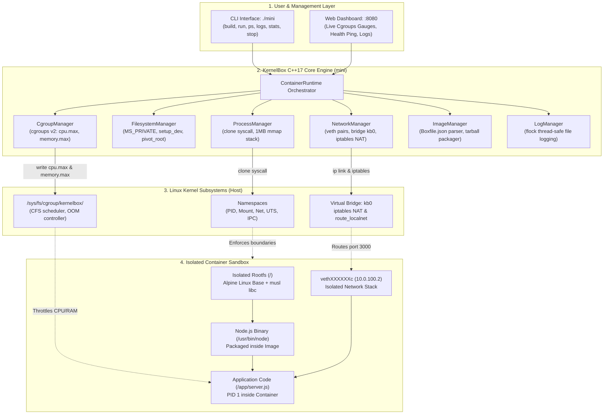

# KernelBox — Lightweight Linux Container Runtime From Scratch

[](https://github.com/sanketWaghmare24-28/Kernel-Box)
[](https://en.cppreference.com/w/cpp/17)
[](https://kernel.org)
[](LICENSE)

> **A Computer Science Engineering Mini-Project**  
> **Author:** [Sanket Waghmare](https://github.com/sanketWaghmare24-28)  
> **Repository:** [sanketWaghmare24-28/Kernel-Box](https://github.com/sanketWaghmare24-28/Kernel-Box)  
> **Language:** C++17, Linux Syscalls, Node.js, Shell  
> **No Docker. No containerd. No libcontainer. Built directly on Linux Kernel Primitives.**

---

## Table of Contents

1. [Project Overview & Philosophy](#1-project-overview--philosophy)
2. [System Architecture Diagram](#system-architecture-diagram)
3. [The Big Question: How Images Run Anywhere (Even with Different/No Node.js)](#2-the-big-question-how-images-run-anywhere)
4. [Core Linux Kernel Primitives Explained](#3-core-linux-kernel-primitives-explained)
5. [Complete Project Directory Structure](#4-complete-project-directory-structure)
6. [In-Depth Code & Module Walkthrough](#5-in-depth-code--module-walkthrough)
   - [6.1 include/common.hpp (Shared Structs & JSON Engine)](#61-includecommonhpp)
   - [6.2 src/main.cpp (CLI Parser & Entry Point)](#62-srcmaincpp)
   - [6.3 src/runtime/container.cpp (Lifecycle Orchestrator)](#63-srcruntimecontainercpp)
   - [6.4 src/process/process_manager.cpp (Process Spawning via clone)](#64-srcprocessprocess_managercpp)
   - [6.5 src/filesystem/rootfs.cpp (Mount Isolation & pivot_root)](#65-srcfilesystemrootfscpp)
   - [6.6 src/cgroups/cgroup_manager.cpp (cgroups v2 Resource Governance)](#66-srccgroupscgroup_managercpp)
   - [6.7 src/network/network_manager.cpp (Bridge, veth & iptables NAT)](#67-srcnetworknetwork_managercpp)
   - [6.8 src/image/image_manager.cpp (Image Builder, Exporter & Importer)](#68-srcimageimage_managercpp)
   - [6.9 src/logging/log_manager.cpp (Thread-Safe File Logging)](#69-srclogginglog_managercpp)
   - [6.10 dashboard/ (Real-Time Web Console & Health Monitor)](#610-dashboard)
7. [Container Creation Step-by-Step Lifecycle (Mermaid Diagram)](#7-container-creation-step-by-step-lifecycle)
8. [Network Architecture & Packet Flow](#8-network-architecture--packet-flow)
9. [cgroups v2 Resource Limiting Mechanics](#9-cgroups-v2-resource-limiting-mechanics)
10. [Step-by-Step Execution Guide](#10-step-by-step-execution-guide)
11. [Packaging & Sharing with a Friend](#11-packaging--sharing-with-a-friend)
12. [College Evaluation & Viva Voce Guide (Top 10 Questions)](#12-college-evaluation--viva-voce-guide)

---

## 1. Project Overview & Philosophy

**KernelBox** (`mini`) is an educational, production-patterned container runtime written in standard C++17 for Linux systems.

Modern developers treat container engines like Docker, Podman, and containerd as "black boxes." When a developer runs `docker run -p 3000:3000 my-app`, Docker does not perform magic—it asks the Linux kernel to create isolated namespaces, restricts hardware resources with control groups (cgroups), sets up virtual network interfaces (`veth` pairs), and switches the root mount with `pivot_root`.

**KernelBox strips away the abstractions.** It proves that:
1. Containers are **not** virtual machines; they are ordinary Linux processes wrapped in kernel boundaries.
2. An **Image** is nothing more than a packaged root filesystem (`rootfs.tar.gz`) combined with a JSON configuration manifest (`manifest.json` / `Boxfile.json`).
3. An application packaged with its dependencies can run on **any** compatible Linux machine without the target machine having the runtime (e.g., Node.js, Python, or Go) installed.

---

## System Architecture Diagram



---

## 2. The Big Question: How Images Run Anywhere

### "What if my friend has a different Node.js version (e.g. Node 14 or Node 22), or has NO Node.js installed at all? How can my image run on their machine?"

This is the most critical question in containerization. Here is the exact technical explanation:

### 2.1 The Two Levels of an Operating System

An operating system consists of two parts:
1. **The Kernel Space:** The Linux kernel (`vmlinuz`) that interacts directly with CPU, memory, and hardware devices.
2. **The User Space:** All the binaries, shared libraries, package managers, and configuration files (`/bin/sh`, `/lib/libc.so`, `/usr/bin/node`, `/etc/resolv.conf`).

When your friend runs software on their machine normally, that software looks for binaries and libraries in **their host's user space** (`/usr/bin/node`, `/usr/lib/x86_64-linux-gnu/`). If your friend has Node.js v14, or if they have nothing installed, running `node server.js` will either execute the wrong version or fail with `command not found`.

### 2.2 How KernelBox Solves This

When you run `sudo ./mini build examples/node-api -t demo-api:v1`:
1. KernelBox downloads a minimal **Alpine Linux User Space** (`alpine-minirootfs`).
2. Inside that Alpine environment, KernelBox runs Alpine's package manager (`apk add nodejs`) to install a specific, known-good Node.js binary (`/usr/bin/node`) along with its exact required shared libraries (`musl libc`, `libuv`, `libcrypto`).
3. KernelBox copies your application code (`server.js`, `package.json`, `node_modules`) into `/app` inside that Alpine filesystem.
4. KernelBox archives the **entire user space** into `rootfs.tar.gz`.

### 2.3 The Isolation Handshake

When your friend runs `sudo ./run.sh` on their computer:
1. `mini import` unpacks that complete user space into `/var/lib/kernelbox/containers/<id>/rootfs`.
2. `mini start` executes `clone(CLONE_NEWNS)`. This creates a brand new, private **Mount Namespace** for the container.
3. Inside this child process, KernelBox calls **`pivot_root("/var/lib/kernelbox/containers/<id>/rootfs", ...)`**.
4. **The entire filesystem seen by the container is replaced.**
   - Inside the container, `/` is the Alpine filesystem you packaged.
   - Inside the container, `/usr/bin/node` is the exact Node.js binary you packaged.
   - The container **cannot see** your friend's host `/usr/bin`, `/lib`, or `/home`.
5. When `execve("/usr/bin/node", ["/usr/bin/node", "server.js"], ...)` executes, it executes the packaged Node.js binary using the packaged Alpine libraries.

```
+-------------------------------------------------------------------------------+
| HOST MACHINE (Friend's Laptop)                                                |
| Node.js: NOT INSTALLED (or different version v14)                             |
| Host Kernel: Linux 5.15 / 6.x / 7.x (Shared Kernel)                          |
|                                                                               |
|   +-----------------------------------------------------------------------+   |
|   | CONTAINER PROCESS (PID inside namespace: 1)                           |   |
|   | Root Directory (/): Isolated Alpine RootFS                            |   |
|   | Node Binary: /usr/bin/node (Packaged inside Image)                    |   |
|   | Libraries: musl libc, libuv (Packaged inside Image)                   |   |
|   | App Code: /app/server.js (Packaged inside Image)                      |   |
|   +-----------------------------------------------------------------------+   |
+-------------------------------------------------------------------------------+
```

**Result:** It does not matter what your friend has installed. The application is 100% self-contained. The only requirement is that the host computer runs a Linux kernel on the x86_64 architecture.

---

## 3. Core Linux Kernel Primitives Explained

KernelBox is built on four core pillars of the Linux kernel:

### 3.1 Linux Namespaces (Isolation)
Namespaces partition kernel resources such that one set of processes sees one set of resources, while another set of processes sees a completely different set.

| Namespace | Linux Flag | What KernelBox Isolates With It |
| :--- | :--- | :--- |
| **PID** | `CLONE_NEWPID` | Process IDs. The container process thinks it is PID 1, while on the host it has an ordinary PID (e.g. 7260). |
| **Mount** | `CLONE_NEWNS` | Filesystem mount points. Mounts created inside the container do not affect the host system. |
| **Network** | `CLONE_NEWNET` | Network stack. Private IP addresses, routing tables, and interface lists (`lo`, `veth`). |
| **UTS** | `CLONE_NEWUTS` | Hostname and NIS domain name. Allows the container to have its own hostname. |
| **IPC** | `CLONE_NEWIPC` | Inter-Process Communication (POSIX message queues, SysV shared memory). |

### 3.2 `pivot_root(2)` vs `chroot(2)` (Filesystem Switching)
- `chroot` only changes the apparent root directory for path resolution. A malicious or privileged process can easily break out of a chroot jail using relative paths (`../../`).
- `pivot_root` changes the root mount point itself. It moves the old root filesystem to a temporary directory (`put_old`), makes the new directory the real root (`/`), and unmounts the old host root completely. Once unmounted, the host filesystem is physically inaccessible to the container.

### 3.3 Control Groups v2 (cgroups v2) (Resource Governance)
cgroups limit and monitor system resources (CPU, Memory, PIDs). KernelBox uses the unified **cgroups v2** filesystem located at `/sys/fs/cgroup`:
- `memory.max`: Sets the hard memory ceiling (e.g., `134217728` bytes = 128 MB). If the container exceeds this, the kernel OOM killer terminates it.
- `cpu.max`: Sets CPU quota and period (e.g., `50000 100000` = 50% of 1 CPU core).
- `cgroup.procs`: Writing a process PID to this file places that process and all its future child threads under control.

### 3.4 Virtual Networking (`veth` pairs & Bridge)
- A **`veth` pair** acts like a virtual Ethernet patch cable. What enters one end automatically exits the other.
- One end (`vethXXXXXXh`) stays in the host network namespace and connects to a software bridge (`kb0`).
- The other end (`vethXXXXXXc`) is injected into the container's private network namespace and assigned an IP address (`10.0.100.2`).
- Host **`iptables`** rules forward external host port traffic (`3000`) across the bridge to the container IP.

---

## 4. Complete Project Directory Structure

```
Kernel-Box/
├── include/                          # Public C++ Header Files
│   ├── common.hpp                    # Shared structures, JSON engine, logging macros
│   ├── cgroups/
│   │   └── cgroup_manager.hpp        # Cgroups v2 management interface
│   ├── filesystem/
│   │   └── rootfs.hpp                # Filesystem isolation & pivot_root interface
│   ├── image/
│   │   └── image_manager.hpp         # Image builder, manifest & archive interface
│   ├── logging/
│   │   └── log_manager.hpp           # Container stdout/stderr logger interface
│   ├── network/
│   │   └── network_manager.hpp       # Bridge (kb0), veth pairs & iptables interface
│   ├── process/
│   │   └── process_manager.hpp       # clone(2) execution & PID tracking interface
│   └── runtime/
│       └── container.hpp             # Container lifecycle orchestration interface
│
├── src/                              # C++ Implementation Files
│   ├── main.cpp                      # CLI entry point (mini build, run, ps, etc.)
│   ├── cgroups/
│   │   └── cgroup_manager.cpp        # Cgroup directory creation & resource limits
│   ├── filesystem/
│   │   └── rootfs.cpp                # setup_mounts, setup_dev, do_pivot_root
│   ├── image/
│   │   └── image_manager.cpp         # Boxfile parser, tarball assembly, import/export
│   ├── logging/
│   │   └── log_manager.cpp           # flock-safe file logging & tailing
│   ├── network/
│   │   └── network_manager.cpp       # ip & iptables command executor
│   ├── process/
│   │   └── process_manager.cpp       # 1MB stack allocation & clone syscall caller
│   └── runtime/
│       └── container.cpp             # Central orchestrator tying all modules together
│
├── examples/                         # Demonstration Applications
│   └── node-api/
│       ├── Boxfile.json              # Image manifest definition (also Portafile.json)
│       ├── package.json              # Node.js project manifest
│       └── server.js                 # HTTP API with /health, /info, / endpoints
│
├── dashboard/                        # Modern Web Management Dashboard
│   ├── package.json                  # Express server definition
│   ├── server.js                     # Backend API bridging web UI with mini CLI
│   └── public/
│       └── index.html                # Dark-mode dashboard, live gauges, terminal log viewer
│
├── scripts/                          # Automation & Packaging Helpers
│   └── package-bundle.sh             # Turnkey packager to build shareable zip for friends
│
├── Makefile                          # Standard build automation script
├── test.sh                           # Automated end-to-end integration test script
└── README.md                         # Comprehensive documentation (this file)
```

---

## 5. In-Depth Code & Module Walkthrough

Here is a detailed line-by-line explanation of every major component in the project.

---

### 5.1 `include/common.hpp`
**Purpose:** Serves as the global contract across all modules. Defines common data models, paths, and includes a zero-dependency JSON parser.

#### Key Structures:
- **`ContainerStatus` Enum:** Tracks whether a container is `CREATED`, `RUNNING`, `STOPPED`, or `REMOVING`.
- **`ImageManifest` Struct:**
  ```cpp
  struct ImageManifest {
      std::string name;
      std::string version;
      std::string tag;
      std::vector<std::string> entrypoint;
      std::vector<std::string> args;
      std::string working_dir;
      std::vector<std::string> env;
      std::vector<std::string> exposed_ports;
      uint64_t size_bytes;
  };
  ```
- **`ContainerState` Struct:** Persisted to disk as `/var/lib/kernelbox/containers/<id>/state.json`. Stores the container's PID, current status, exit code, and resource limit strings.
- **`kernelbox::json` Namespace:** To keep the project free of heavy third-party libraries (like nlohmann/json), this namespace provides pure C++ string parsing functions:
  - `get_string(json, key)`: Finds `"key": "value"` using substring matching.
  - `get_int(json, key)`: Finds `"key": 123` and converts to integer.
  - `get_array(json, key)`: Parses arrays of strings such as `["node", "server.js"]`.

> **Architectural Note (JSON vs SQLite):**
> While an SQLite container registry was initially considered in preliminary project proposals, KernelBox deliberately adopts an air-gapped, zero-dependency filesystem metadata layout (`/var/lib/kernelbox/containers/<id>/state.json`, `network.conf`, `ports.conf`). This removes third-party C library linkage requirements, ensuring the runtime binary remains 100% self-contained, easily inspectable, and auditable on any minimal Linux environment.

---

### 5.2 `src/main.cpp`
**Purpose:** Command-Line Interface (CLI) entry point. Parses command line arguments and dispatches commands to the runtime or image manager.

#### Supported Commands:
- `mini build <context_dir> -t <tag>`: Calls `ImageManager::build()`.
- `mini images`: Calls `ImageManager::list()` and prints a formatted repository table.
- `mini run <image> [options]`: Parses `--name`, `--publish`, `--cpu`, `--memory`, and `-d`. Calls `ContainerRuntime::create()` followed by `ContainerRuntime::start()`.
- `mini ps`: Queries `ContainerRuntime::list()` to display active and stopped containers.
- `mini logs <id>`: Fetches output using `ContainerRuntime::logs()`.
- `mini stats <id>`: Queries `CgroupManager::get_stats()` to display CPU time, memory bytes, and process counts.
- `mini stop <id>`: Sends signals to cleanly terminate the container process.
- `mini rm <id>`: Deletes container files from disk.
- `mini export <tag> -o <file>`: Packages an image for transfer.
- `mini import <file>`: Unpacks a portable image archive.

---

### 5.3 `src/runtime/container.cpp`
**Purpose:** The central coordinator. Connects the filesystem, process manager, cgroups, network manager, and logging manager.

#### Deep Dive: `create()`
1. Validates container name using alphanumeric regex rules.
2. Generates a random 12-character hex ID using `<random>`.
3. Creates container directory structure: `/var/lib/kernelbox/containers/<id>/rootfs`.
4. Extracts the image's `rootfs.tar.gz` into the container's root directory.
5. Saves port mappings to `ports.conf` and initial metadata to `state.json`.

#### Deep Dive: `start()`
1. **Resource Setup:** Calls `CgroupManager::create(id)` and sets CPU and Memory limits.
2. **Network Setup:** Calls `NetworkManager::setup_bridge()` to ensure `kb0` is active.
3. **Log Preparation:** Opens `/var/lib/kernelbox/containers/<id>/logs/container.log` in append mode.
4. **Process Launch:** Calls `ProcessManager::spawn()` with namespace flags:
   ```cpp
   int flags = CLONE_NEWNS | CLONE_NEWPID | CLONE_NEWUTS | CLONE_NEWIPC | CLONE_NEWNET;
   ```
5. **Pre-Exec Hook:** Before the child calls `execve`, the child runs:
   - `filesystem::setup_mounts(rootfs)`
   - `filesystem::setup_dev(rootfs)`
   - `filesystem::do_pivot_root(rootfs)`
6. **Post-Clone Hook (Host side):**
   - Places the child PID into the cgroup: `cm.add_process(id, pid)`.
   - Creates the virtual Ethernet pair: `nm.create_veth_pair(id, pid)`.
   - Configures container interface and IP: `nm.configure_container_network(id, pid)`.
   - Adds iptables forwarding rules: `nm.add_port_mapping(...)`.
7. **Detached Execution:** In detached mode (`-d`), `start()` records the running PID in `state.json` and returns immediately. In foreground mode, it calls `ProcessManager::wait_for(pid)` to block until exit.

---

### 5.4 `src/process/process_manager.cpp`
**Purpose:** Directly calls the Linux `clone(2)` system call to create isolated processes.

#### Why `clone()` and not `fork()`?
`fork()` duplicates the calling process with identical namespaces. `clone()` accepts specific bitwise flags (`CLONE_NEW*`) that tell the kernel to create fresh, blank namespace tables for the child process.

```cpp
pid_t ProcessManager::spawn(...) {
    // 1. Allocate an isolated 1MB memory stack for the child process
    constexpr int STACK_SIZE = 1024 * 1024;
    void* stack = mmap(nullptr, STACK_SIZE, PROT_READ | PROT_WRITE,
                       MAP_PRIVATE | MAP_ANONYMOUS | MAP_STACK, -1, 0);

    // Stacks grow downwards on x86_64, so stack pointer points to the top
    void* stack_top = static_cast<char*>(stack) + STACK_SIZE;

    // 2. Clone the process with namespace flags
    pid_t pid = clone(child_fn, stack_top, clone_flags | SIGCHLD, &data);

    // 3. Free stack in parent (child has its own address space due to clone)
    munmap(stack, STACK_SIZE);
    return pid;
}
```

#### What happens inside `child_fn`?
1. `sethostname(hostname)`: Sets the container's isolated hostname (UTS namespace).
2. `dup2(log_fd, STDOUT_FILENO)` & `dup2(log_fd, STDERR_FILENO)`: Redirects all standard output and errors into the container log file.
3. Runs the `pre_exec_setup` callback (which executes `pivot_root`).
4. `chdir(working_dir)`: Changes working directory to `/app`.
5. `execve(c_args[0], c_args.data(), c_env.data())`: Replaces the child process image with the target executable (`/usr/bin/node`).

---

### 5.5 `src/filesystem/rootfs.cpp`
**Purpose:** Configures mount namespaces, mounts virtual kernel filesystems (`/proc`, `/sys`, `/dev`), and executes `pivot_root`.

#### Preventing Mount Leaks (`MS_PRIVATE`):
By default in modern Linux (Systemd), mount points are marked as "shared" (`MS_SHARED`). This means mounts created inside a mount namespace might propagate back to the host!
To stop this, KernelBox marks the container's entire mount tree as private:
```cpp
mount(nullptr, "/", nullptr, MS_REC | MS_PRIVATE, nullptr);
```

#### The `pivot_root` Sequence:
Linux requires that both the old root and new root are distinct mount points.
1. Bind-mount the new rootfs onto itself:
   ```cpp
   mount(rootfs_path.c_str(), rootfs_path.c_str(), nullptr, MS_BIND | MS_REC, nullptr);
   ```
2. Create temporary directory `put_old` inside the rootfs:
   ```cpp
   mkdir("/var/lib/kernelbox/.../rootfs/put_old", 0777);
   ```
3. Execute the `pivot_root` syscall:
   ```cpp
   syscall(SYS_pivot_root, new_root.c_str(), put_old.c_str());
   ```
4. `chdir("/")`: Changes current working directory to the new root.
5. `umount2("/put_old", MNT_DETACH)`: Lazily unmounts the old host root so the container process cannot reach back into host files.
6. `rmdir("/put_old")`: Removes the temporary folder.

#### Essential Device Nodes:
A containerized Node.js application will crash if `/dev/null` or `/dev/urandom` does not exist.
KernelBox creates essential character devices:
```cpp
mknod("dev/null",    S_IFCHR | 0666, makedev(1, 3));
mknod("dev/zero",    S_IFCHR | 0666, makedev(1, 5));
mknod("dev/urandom", S_IFCHR | 0666, makedev(1, 9));
```
*Note:* If the host system blocks `mknod` inside an unprivileged user namespace, KernelBox automatically falls back to bind-mounting the host's `/dev` devices.

---

### 5.6 `src/cgroups/cgroup_manager.cpp`
**Purpose:** Interacts with the Linux cgroups v2 virtual filesystem to apply hard CPU and memory limits.

#### Directory Layout:
Under cgroups v2, groups are represented as simple directories:
```
/sys/fs/cgroup/kernelbox/
├── cgroup.subtree_control       # "+cpu +memory +pids"
└── <container_id>/
    ├── cgroup.procs             # Contains child PID (e.g. 7260)
    ├── cpu.max                  # Quota: "50000 100000" (50% CPU)
    ├── memory.max               # Limit in bytes: "134217728" (128 MB)
    ├── memory.current           # Current usage in bytes
    └── pids.current             # Number of active tasks
```

#### How Limits are Applied:
- **Memory Limit:** KernelBox parses user strings like `128m` or `1g` into raw byte counts (`134217728`) and writes them directly to `/sys/fs/cgroup/kernelbox/<id>/memory.max`.
- **CPU Quota:** Writes `"<quota> <period>"` into `cpu.max`. A period of 100,000 microseconds (100ms) with a quota of 50,000 limits the container to 50ms of CPU time per 100ms cycle (0.5 cores).
- **Process Attachment:** Writing the container PID to `cgroup.procs` moves the process into the control group. Any process spawned by Node.js automatically inherits this group.

---

### 5.7 `src/network/network_manager.cpp`
**Purpose:** Sets up Linux virtual Ethernet interfaces, software bridges, and iptables NAT routing.

#### Network Architecture:
1. **Bridge `kb0`:** Created on the host with IP `10.0.100.1/24`.
2. **`veth` pair creation:**
   ```bash
   ip link add vethXXXXXXh type veth peer name vethXXXXXXc
   ip link set vethXXXXXXh master kb0
   ip link set vethXXXXXXh up
   ```
3. **Cross-Namespace Migration:** Moves `vethXXXXXXc` from the host into the container's network namespace:
   ```bash
   ip link set vethXXXXXXc netns <container_pid>
   ```
4. **Container Network Configuration & IP Pool:** KernelBox manages an atomic IP address pool (`10.0.100.2` to `10.0.100.254`) protected by file locking (`.network_ip_pool.lock`). Using `nsenter -t <pid> -n`, KernelBox sets up the interface inside the container:
   ```bash
   ip addr add 10.0.100.X/24 dev vethXXXXXXc
   ip link set vethXXXXXXc up
   ip link set lo up
   ip route add default via 10.0.100.1
   ```
5. **Port Forwarding with `iptables`:**
   ```bash
   # Route incoming packets on host port to container IP
   iptables -t nat -A PREROUTING -p tcp --dport 3000 -j DNAT --to-destination 10.0.100.2:3000
   iptables -t nat -A OUTPUT -p tcp --dport 3000 -j DNAT --to-destination 10.0.100.2:3000
   # Masquerade traffic entering bridge so replies return to host
   iptables -t nat -A POSTROUTING -o kb0 -j MASQUERADE
   # Allow routing to localhost destination across bridge
   sysctl -w net.ipv4.conf.kb0.route_localnet=1
   ```

---

### 5.8 `src/image/image_manager.cpp`
**Purpose:** Defines our own image format, builds images from a `Boxfile.json` (or `Portafile.json`), and exports/imports self-contained archives.

#### The `Boxfile.json` Specification:
```json
{
  "name": "demo-api",
  "version": "v1",
  "base": "alpine",
  "entrypoint": ["/usr/bin/node"],
  "args": ["server.js"],
  "working_dir": "/app",
  "env": ["NODE_ENV=production", "PORT=3000"],
  "exposed_ports": ["3000"],
  "copy": ["."]
}
```

#### Image Directory Structure:
```
/var/lib/kernelbox/images/demo-api_v1/
├── manifest.json       # Parsed manifest metadata
└── rootfs.tar.gz       # Complete compressed Alpine + Node.js + App filesystem
```

#### Path Traversal Protection (`validate_archive_paths`):
To prevent malicious tar archives (Zip-Slip vulnerability) from overwriting host files during `mini import`, KernelBox inspects every archive entry before extracting. If an entry begins with `/` or contains `..`, it is immediately rejected.

---

### 5.9 `src/logging/log_manager.cpp`
**Purpose:** Captures container output reliably without blocking the main runtime.
- Creates `/var/lib/kernelbox/containers/<id>/logs/container.log`.
- In detached mode (`-d`), the container process's file descriptors `1` (stdout) and `2` (stderr) are directly redirected to this log file at spawn time, ensuring zero overhead stream capture.
- `LogManager::write()` is available for out-of-band operational event logging, utilizing `flock(fd, LOCK_EX)` for thread safety.
- `LogManager::read()` supports reading container logs and tailing the last `N` lines.

---

### 5.10 `dashboard/`
**Purpose:** A modern web-based monitoring console built with Node.js and Express.

#### Architecture & Scope:
- `server.js`: Listens on `http://localhost:8080`. Implements REST endpoints:
  - `GET /api/containers`: Calls `mini ps` and safely parses container table records.
  - `GET /api/stats/:id`: Calls `mini stats <id>` to retrieve cgroups CPU and memory metrics.
  - `GET /api/logs/:id`: Retrieves container stdout/stderr.
  - `GET /api/health/:id`: Dynamically reads container IP and port mappings from metadata and probes `/health` with bounded timeouts.
  - `POST /api/containers/:id/stop`: Stops the container.
  - `POST /api/containers/:id/rm`: Removes the container.
- `public/index.html`: Modern, responsive single-page application:
  - Dark-mode developer theme.
  - Live animated gauges for memory consumption vs limit.
  - Real-time API response inspection card.
  - Terminal modal window with live log stream filtering and copy controls.

> **Operational Scope Notice:**
> The web console acts as an observation, metrics inspection, and lifecycle termination console. Container creation (`mini run`) and image compilation (`mini build`) remain terminal CLI commands by architectural design to avoid exposing privileged root-level container generation over unauthenticated HTTP.

---

## 6. Container Creation Step-by-Step Lifecycle

```mermaid
sequenceDiagram
    autonumber
    actor User as User / CLI (mini)
    participant RT as ContainerRuntime
    participant IM as ImageManager
    participant FS as Filesystem Module
    participant CG as CgroupManager
    participant PM as ProcessManager
    participant NM as NetworkManager
    participant Child as Container (Child Process)

    User->>RT: mini run demo-api:v1 -d
    RT->>IM: Extract rootfs.tar.gz to /var/lib/kernelbox/containers/<id>/rootfs
    RT->>CG: Create /sys/fs/cgroup/kernelbox/<id> & set cpu/mem limits
    RT->>NM: Ensure bridge kb0 exists (10.0.100.1/24)
    RT->>PM: spawn(clone flags: NEWNS, NEWPID, NEWNET, NEWUTS, NEWIPC)
    
    rect rgb(20, 30, 45)
        Note over PM,Child: Child process is created in new namespaces
        Child->>Child: sethostname("demo-api-1")
        Child->>FS: setup_mounts (mount /proc, /sys, /dev)
        Child->>FS: do_pivot_root (swap rootfs, unmount old root)
        Child->>Child: chdir("/app")
    end

    RT->>CG: Write child PID to cgroup.procs
    RT->>NM: Create veth pair & move vethXXXXc into child netns
    RT->>NM: Assign 10.0.100.2/24 & configure default route via kb0
    RT->>NM: Set iptables DNAT & MASQUERADE rules for port 3000

    rect rgb(20, 30, 45)
        Child->>Child: execve("/usr/bin/node", ["node", "server.js"], env)
        Note over Child: Process replaces memory image with Node.js
    end

    RT-->>User: Prints Container ID & returns (Detached Mode)
```



---

## 7. Network Architecture & Packet Flow

When a user on the host computer visits `http://127.0.0.1:3000/health` or `http://10.0.100.2:3000/health`:

```
+-----------------------------------------------------------------------------------------+
| HOST NETWORK NAMESPACE                                                                  |
|                                                                                         |
|  curl http://127.0.0.1:3000                                                             |
|         |                                                                               |
|         v                                                                               |
|  [iptables PREROUTING / OUTPUT]                                                         |
|  Destination 127.0.0.1:3000 rewritten to 10.0.100.2:3000 (DNAT)                        |
|         |                                                                               |
|         v                                                                               |
|  [Bridge: kb0] (10.0.100.1)                                                             |
|         |                                                                               |
|         v                                                                               |
|  [Interface: vethXXXXXXh]                                                               |
+---------|-------------------------------------------------------------------------------+
          |  (Virtual Ethernet Cable)
+---------|-------------------------------------------------------------------------------+
| CONTAINER NETWORK NAMESPACE (PID 30583)                                                 |
|         v                                                                               |
|  [Interface: vethXXXXXXc] (10.0.100.2)                                                  |
|         |                                                                               |
|         v                                                                               |
|  [Node.js HTTP Server] listening on 0.0.0.0:3000                                        |
|         |                                                                               |
|         v                                                                               |
|  Response: {"status": "healthy", "uptime": 12.4}                                        |
+-----------------------------------------------------------------------------------------+
```

---

## 8. cgroups v2 Resource Limiting Mechanics

### 8.1 Memory Enforcement
- When you pass `--memory 128m`, KernelBox writes `134217728` to `/sys/fs/cgroup/kernelbox/<id>/memory.max`.
- If Node.js attempts to allocate more than 128 MB of RAM, the Linux kernel Out-Of-Memory (OOM) killer intervenes.
- The kernel halts the process immediately, preventing runaway memory leaks from affecting the host operating system.

### 8.2 CPU Quota Enforcement
- When you pass `--cpu "50000 100000"`, the kernel uses the Completely Fair Scheduler (CFS) bandwidth control.
- In every 100,000 microsecond (100 millisecond) window, the container is permitted to occupy the CPU for at most 50,000 microseconds (50 milliseconds).
- Once the 50ms quota is exhausted, the kernel throttles the container's threads until the next period begins.

---

## 9. Step-by-Step Execution Guide

### 9.1 Cloning and Compiling the Runtime
```bash
git clone https://github.com/sanketWaghmare24-28/Kernel-Box.git
cd Kernel-Box

# Compile the runtime
g++ -std=c++17 -Wall -Wextra -Iinclude -pthread src/*.cpp src/*/*.cpp -o mini
```

### 9.2 Building the Demonstration Image
```bash
sudo ./mini build examples/node-api -t demo-api:v1
```
*Note: On the first run, KernelBox will automatically download the minimal Alpine root filesystem and install Node.js inside it.*

### 9.3 Listing Available Images
```bash
sudo ./mini images
```
Output:
```
REPOSITORY          TAG                 SIZE (KB)      
demo-api            v1                  22996          
```

### 9.4 Running a Container
```bash
sudo ./mini run demo-api:v1 --name demo-1 --publish 3000:3000 --memory 128m -d
```

### 9.5 Inspecting Container Status
```bash
sudo ./mini ps
```
Output:
```
CONTAINER ID   IMAGE          STATUS         NAMES
8735d06fbbb0   demo-api:v1    Running        demo-1
```

### 9.6 Testing the Containerized Backend
```bash
# Health check endpoint
curl http://10.0.100.2:3000/health

# System information endpoint (shows isolated hostname and container memory)
curl http://10.0.100.2:3000/info
```

### 9.7 Viewing Resource Stats & Logs
```bash
# View cgroups metrics
sudo ./mini stats demo-1

# View stdout logs
sudo ./mini logs demo-1
```

### 9.8 Stopping and Removing Containers
```bash
sudo ./mini stop demo-1
sudo ./mini rm demo-1
```

### 9.9 Running the Web Dashboard
```bash
cd dashboard
npm install
node server.js
```
Open **`http://localhost:8080`** in your browser.

### 9.10 Running Regression Tests
Run the complete automated test suite using the top-level Makefile:
```bash
make test
```
Or run individual suites:
```bash
# Dashboard security and integration unit tests
cd dashboard && npm test

# C++ kernel module tests (image validation, cgroups, process handshake, IP pool)
cd ..
sh tests/run-linux-tests.sh
```
The dashboard tests use Node.js's built-in test runner (`node --test`). The C++ regression tests require Linux and `g++`.

---

## 10. Packaging & Sharing with a Friend

KernelBox includes a packaging script that bundles the C++ runtime binary, the image archive, and a one-click launcher into a single shareable tarball:

### On Your Computer:
```bash
cd Kernel-Box
chmod +x scripts/package-bundle.sh
./scripts/package-bundle.sh
```
This generates **`kernelbox-demo.tar.gz`** (~23 MB). Send this file to your friend.

### On Your Friend's Computer (Zero Dependencies Required!):
Your friend does **not** need Node.js or Docker installed. They run:
```bash
tar -xzf kernelbox-demo.tar.gz
cd kernelbox-demo
sudo ./run.sh
```
The script will:
1. Import `demo-api.tar.gz` into KernelBox.
2. Launch the container with memory limits and port publishing.
3. Automatically execute `curl http://10.0.100.2:3000/health` to prove the backend is running.

To stop the container, your friend runs:
```bash
sudo ./stop.sh
```

---

## 11. College Evaluation & Viva Voce Guide

### Q1: What is the difference between a Container and a Virtual Machine?
**Answer:** A Virtual Machine virtualizes the physical hardware using a Type-1 or Type-2 Hypervisor (e.g., KVM, VMware). It boots a full, independent guest operating system kernel, which requires significant RAM and startup time. A Container shares the host Linux kernel directly. It is simply an ordinary process constrained by Linux **Namespaces** (for visibility isolation) and **cgroups** (for resource limits). Containers provide near-instant startup and zero virtualization overhead.

### Q2: Why did you use `pivot_root` instead of `chroot`?
**Answer:** `chroot` only changes the path resolution prefix for the current process. A process with root privileges can easily break out of a chroot jail (e.g., by creating a nested directory and executing `chdir("..")`). `pivot_root` changes the mount namespace's actual root mount point and unmounts the old host filesystem (`MNT_DETACH`), making escape physically impossible because the host filesystem no longer exists in the container's mount namespace.

### Q3: Why did you use `clone` instead of `fork` followed by `unshare`?
**Answer:** `fork` creates an identical duplicate of the calling process in the exact same namespaces. Calling `unshare` afterwards requires extra context-switching steps. `clone(2)` allows us to specify atomic namespace flags (`CLONE_NEWPID | CLONE_NEWNS | CLONE_NEWNET | CLONE_NEWUTS | CLONE_NEWIPC`) directly during process instantiation. This ensures the child process is born directly inside its isolated jail before executing any user code.

### Q4: How does process isolation work in the PID namespace?
**Answer:** When `CLONE_NEWPID` is passed, the Linux kernel creates a nested PID translation table. To the container process, it appears as PID 1 (acting as the init process). On the host operating system, the process has a standard global PID (e.g., 30583). When the container process inspects `/proc`, it only sees processes within its own PID namespace; host processes are completely invisible.

### Q5: How do cgroups v2 differ from legacy cgroups v1?
**Answer:** In cgroups v1, every resource controller (CPU, Memory, Block I/O) maintained its own separate directory hierarchy, causing synchronization issues and race conditions. cgroups v2 introduces a **single unified hierarchy** where all resource controllers are governed under the same tree directory structure (`/sys/fs/cgroup`), ensuring consistent multi-resource governance.

### Q6: How does network traffic reach the container from the host?
**Answer:** We establish a Virtual Ethernet pair (`veth`). One interface (`vethXXXXXXh`) attaches to a host software bridge (`kb0`), while the peer interface (`vethXXXXXXc`) is moved into the container's network namespace. Using `iptables` Destination NAT (DNAT), packets arriving at host port 3000 are rewritten and routed across `kb0` to the container's private IP (`10.0.100.2:3000`).

### Q7: Why do we need `sysctl net.ipv4.conf.kb0.route_localnet=1`?
**Answer:** By default, the Linux kernel drops reply packets from a software bridge if the source or destination IP is in the loopback subnet (`127.0.0.0/8`) to prevent IP spoofing attacks (Martian packet filtering). Setting `route_localnet=1` instructs the kernel to permit localhost routing across the bridge interface, allowing host `curl http://127.0.0.1:3000` to complete successfully.

### Q8: What prevents mounts inside the container from affecting the host?
**Answer:** Before mounting `/proc`, `/sys`, or the new root filesystem, KernelBox marks the entire mount tree as private using `mount(nullptr, "/", nullptr, MS_REC | MS_PRIVATE, nullptr)`. This severs mount propagation between the host and the container's mount namespace.

### Q9: How can your friend run the Node.js backend without having Node.js installed?
**Answer:** The image archive contains a full Alpine Linux root filesystem with the Node.js runtime (`/usr/bin/node`) and all required shared libraries (`musl libc`) pre-installed inside it. Because KernelBox switches the container's root filesystem using `pivot_root`, Node.js executes directly against its own bundled libraries, requiring zero dependencies from the host system.

### Q10: What are the current limitations of KernelBox compared to Docker?
**Answer:** 
1. **OverlayFS:** Docker uses a Copy-on-Write (CoW) layered union filesystem (OverlayFS) to share base image layers across containers. KernelBox currently unpacks full root filesystem copies.
2. **Rootless Execution:** Docker/Podman supports unprivileged user namespaces (`CLONE_NEWUSER`). KernelBox currently requires `sudo` because creating bridge interfaces and writing to root cgroups requires `CAP_NET_ADMIN` and `CAP_SYS_ADMIN`.
3. **Seccomp Filters:** Production runtimes filter forbidden system calls using Seccomp BPF filters, which can be added as a future enhancement.

---

## 12. Conclusion & Engineering Highlights

KernelBox demonstrates that containerization is not virtualization. By directly orchestrating **Linux Namespaces**, **cgroups v2**, **pivot_root**, and **virtual networking** in C++17, this project demystifies container engines and provides a complete, working, portable runtime suitable for production learning and systems engineering demonstrations.
