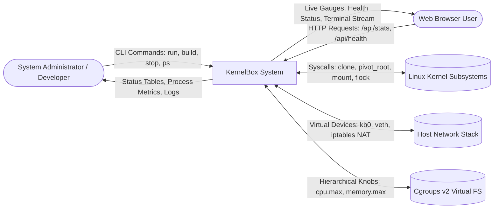
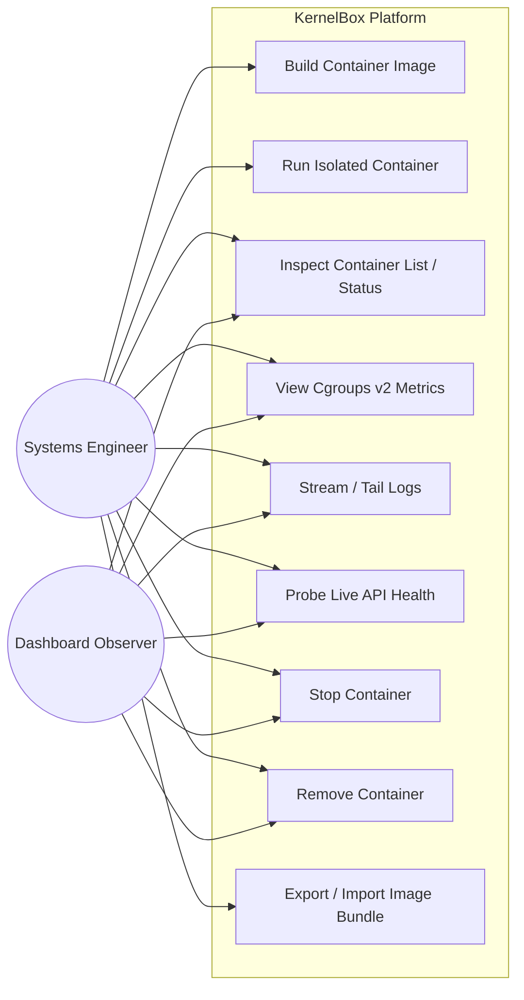
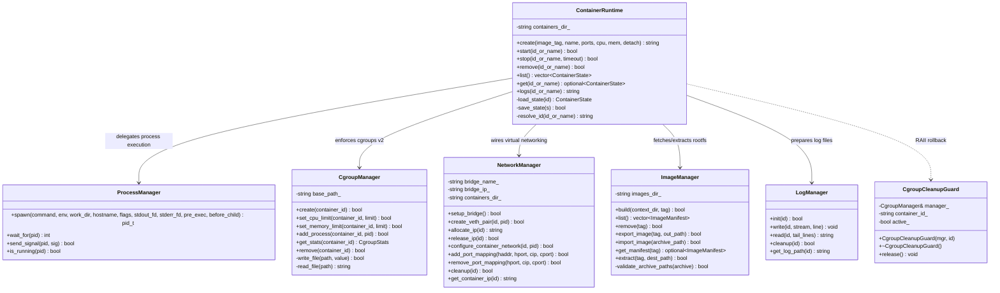
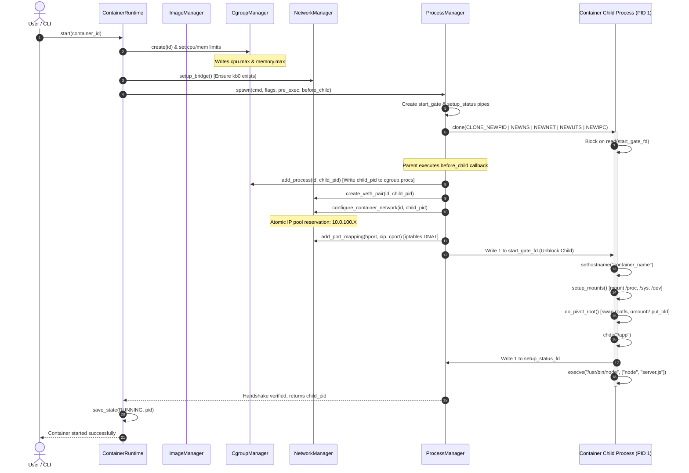

# KernelBox: Academic Evaluation Dossier & Technical Design Specification
**Course:** TE Semester V Mini Project (Odd Sem 2026–27)
**Institution:** Sardar Patel Institute of Technology (Autonomous Institute Affiliated to University of Mumbai), Munshi Nagar, Andheri (West), Mumbai – 400 058
**Department:** Department of Computer Engineering
**Project Group:** Group 38
**Project Title:** Design and Implementation of a Lightweight Linux Container Runtime using Linux Namespaces and cgroups for Process Isolation and Resource Management
**Team Members:**
1. **Akshay Talpade** (UCID / Roll No. 2024300254) — Core Runtime, Synchronization Handshake, Security & Testing
2. **Sanket Waghmare** (UCID / GitHub: `sanketWaghmare24-28`) — System Architecture, Networking, Cgroups v2
3. **Sejal Soni** (UCID / Student 3) — Management Layer, Web Dashboard, Documentation & SRS
**Academic Course Mappings:** CE206 (Operating Systems), CE207 (Design and Analysis of Algorithms), CE208 (Computer Communications and Networks), CE302 (Software Engineering)

---

## Table of Contents
1. [Phase 2 — Software Requirement Specification (SRS)](#1-phase-2--software-requirement-specification-srs)
2. [Phase 2 — Architectural & Design Diagrams (DFD & UML)](#2-phase-2--architectural--design-diagrams-dfd--uml)
3. [Phase 2 — Algorithm Design & Pseudocode](#3-phase-2--algorithm-design--pseudocode)
4. [Phase 3 — Requirements Traceability & Implementation Evidence](#4-phase-3--requirements-traceability--implementation-evidence)
5. [Phase 4 — P1: Front-end / Backend Integration Audit](#5-phase-4--p1-front-end--backend-integration-audit)
6. [Phase 4 — P2: Functional & Non-Functional Testing Matrix](#6-phase-4--p2-functional--non-functional-testing-matrix)
7. [Phase 4 — P3: Technical Project Report Alignment](#7-phase-4--p3-technical-project-report-alignment)
8. [Phase 4 — P4: Presentation, Viva Voce Guide & Live Demo Script](#8-phase-4--p4-presentation-viva-voce-guide--live-demo-script)
9. [Known Limitations & Future Scope](#9-known-limitations--future-scope)

---

## 1. Phase 2 — Software Requirement Specification (SRS)

### 1.1 Problem Statement & Objectives
Modern container engines (such as Docker, Podman, and containerd) abstract low-level kernel interfaces behind multi-tier software daemons. While convenient for application deployment, this abstraction obscures how the Linux kernel establishes isolation boundaries, enforces hardware quotas, switches filesystem trees, and manages virtual packet routing.

The primary objectives of **KernelBox** are:
1. To design and implement a lightweight, self-contained container runtime in standard C++17 (`mini`) interacting directly with Linux kernel system calls without relying on Docker, containerd, or runc.
2. To provide visibility into Linux kernel primitives: **Namespaces** (`clone`), **cgroups v2** (`/sys/fs/cgroup`), **filesystem switching** (`pivot_root`), and **virtual networking** (`veth`, software bridge `kb0`, and `iptables` NAT).
3. To package self-contained application images from an Alpine Linux root filesystem and run them across compatible Linux hosts with zero local dependency requirements.
4. To provide a modern web-based observability dashboard (`dashboard/`) for inspecting container state, live cgroups resource metrics, log streams, and application health.

### 1.2 System Scope & Stakeholders
- **System Scope:** An educational, user-space container runtime operating on Linux (x86_64) kernels supporting cgroups v2, with a companion web monitoring dashboard.
- **Primary Stakeholders:** Computer Science & Systems Engineering students, academic evaluators, systems programming educators, and software engineers learning operating systems internals.

### 1.3 Functional Requirements (FR)

| Req ID | Component | Requirement Description |
| :--- | :--- | :--- |
| **FR-01** | Process Isolation | The runtime must spawn container processes with independent namespace tables: PID (`CLONE_NEWPID`), Mount (`CLONE_NEWNS`), Network (`CLONE_NEWNET`), Hostname (`CLONE_NEWUTS`), and IPC (`CLONE_NEWIPC`). |
| **FR-02** | Atomic Handshake | A two-way pipe synchronization handshake must prevent the child process from executing application code until the parent has placed the child PID into the cgroup and attached network interfaces. |
| **FR-03** | Mount Isolation | The runtime must mark the container mount tree as private (`MS_REC \| MS_PRIVATE`) before performing mounts to prevent propagation to the host operating system. |
| **FR-04** | Rootfs Pivot | The runtime must swap root filesystems using `pivot_root(2)` into the extracted container rootfs and lazily unmount the old host root (`MNT_DETACH`). |
| **FR-05** | Essential Devices | Essential character device nodes (`/dev/null`, `/dev/zero`, `/dev/random`, `/dev/urandom`, `/dev/tty`) and standard streams (`/dev/stdin`, `stdout`, `stderr`) must be established in the container rootfs. |
| **FR-06** | Resource Limits | Hard memory caps (`memory.max`) and Completely Fair Scheduler (CFS) CPU quotas (`cpu.max`) must be written directly to the container's unified cgroups v2 directory. |
| **FR-07** | Network Allocation | An atomic IP address allocator must assign unique IPv4 addresses from the pool `10.0.100.2`–`10.0.100.254` across multiple concurrent container launches using file-locked state tracking. |
| **FR-08** | Virtual Networking | A software bridge (`kb0`, `10.0.100.1/24`) and virtual Ethernet pair (`veth*h` and `veth*c`) must connect the host and container network namespaces. |
| **FR-09** | Port Forwarding | Inbound TCP traffic targeting published host ports must be rewritten to the container IP and port using `iptables` Destination NAT (DNAT). |
| **FR-10** | Image Packaging | Application files and manifests (`Boxfile.json`) must be bundled with base Alpine root filesystems into portable tarballs (`rootfs.tar.gz`), rejecting path-traversal entries. |
| **FR-11** | Resource Rollback | Failed container startup must immediately invoke RAII guards to clean up created cgroups, unbind network interfaces, delete veth pairs, and purge iptables rules. |
| **FR-12** | Web Observability | An Express web console must provide container listing (`/api/containers`), live cgroups metrics (`/api/stats/:id`), tail logs (`/api/logs/:id`), and dynamic health probes (`/api/health/:id`). |

### 1.4 Non-Functional Requirements (NFR)

| Req ID | Category | Requirement Description |
| :--- | :--- | :--- |
| **NFR-01** | Performance | Container startup latency (detached mode) must not exceed 2.0 seconds after image extraction. |
| **NFR-02** | Security (Injection) | Command execution in image builders and dashboard servers must use direct argument-vector execution (`execvp` / `execFile`) without passing through a shell interpreter. |
| **NFR-03** | Security (Archive) | Image extraction must inspect tarball headers (`tar -tf`) to block Zip-Slip path traversal (absolute paths or `..`). |
| **NFR-04** | Robustness | Subprocess commands in the web dashboard must enforce a bounded 5-second timeout to prevent request hanging caused by password prompts or unhandled failures. |
| **NFR-05** | Portability | All shell scripts must maintain LF line endings and standard POSIX `/bin/sh` or `/bin/bash` compliance. C++ code must adhere strictly to ISO C++17. |
| **NFR-06** | Maintainability | Zero third-party dynamic C library dependencies. JSON parsing and logging must be implemented as clean, standalone modules. |

### 1.5 Hardware, Software & Environmental Interfaces
- **Target OS:** Linux Kernel 5.15+ (tested on Linux 6.6 WSL2 Ubuntu 24.04).
- **Required Linux Capabilities:** `CAP_SYS_ADMIN` (for mount, pivot_root, clone namespaces), `CAP_NET_ADMIN` (for bridge, veth, iptables).
- **Core Host Utilities:** `ip` (`iproute2`), `iptables`, `tar`, `wget`, `g++` (GCC 11+ supporting C++17), `make`, `node` (Node.js v18+).

---

## 2. Phase 2 — Architectural & Design Diagrams (DFD & UML)

### 2.1 Context Diagram (DFD Level 0)



### 2.2 Data Flow Diagram (DFD Level 1)

```mermaid
graph TD
    User([CLI / Web Dashboard]) -->|1. Parse Command & Args| Main[1.0 CLI & Dispatcher (main.cpp / server.js)]

    Main -->|2. Build Request| IM[2.0 Image Manager]
    IM -->|Read Context & Boxfile.json| BuildFS[(Context Filesystem)]
    IM -->|Create rootfs.tar.gz| ImgStore[(/var/lib/kernelbox/images)]

    Main -->|3. Run Request| CR[3.0 Container Runtime Orchestrator]
    CR -->|Read Manifest & Extract Rootfs| ImgStore
    CR -->|Write Container State| StateStore[(/var/lib/kernelbox/containers)]

    CR -->|4. Create Resource Group| CM[4.0 Cgroups Manager]
    CM -->|Write cpu.max, memory.max| CGTree[(/sys/fs/cgroup/kernelbox)]

    CR -->|5. Allocate IP & Wire Veth| NM[5.0 Network Manager]
    NM -->|Lock & Allocate 10.0.100.X| IPPool[(.network_ip_pool.lock)]
    NM -->|Create veth pair & DNAT rules| NetStack[(Linux Bridge kb0 & iptables)]

    CR -->|6. Spawn Child with clone| PM[6.0 Process Manager]
    PM -->|Two-way Sync Handshake| Child[7.0 Container Process PID 1]

    Child -->|Setup Mounts & pivot_root| RootFS[(Isolated Container Root)]
    Child -->|Exec Application Binary| AppCode[(Running Application)]

    AppCode -->|Stdout / Stderr Output| LogMgr[8.0 Log Manager]
    LogMgr -->|Append Stream| LogStore[(container.log)]

    User -->|Query Stats & Probe Health| Dash[9.0 Observability Dashboard]
    Dash -->|Read Metrics| CGTree
    Dash -->|Probe Endpoint| AppCode
```

### 2.3 UML Use Case Diagram



### 2.4 UML Class Diagram



### 2.5 UML Sequence Diagram (Container Creation & Startup Handshake)



### 2.6 UML State Transition Diagram

```mermaid
stateDiagram-v2
    [*] --> CREATED: mini run / ContainerRuntime::create()

    CREATED --> RUNNING: ContainerRuntime::start() [Handshake OK]
    CREATED --> [*]: mini rm / ContainerRuntime::remove()

    state RUNNING {
        [*] --> Initializing: Namespaces & Mounts
        Initializing --> ActiveWorkload: execve(target_binary)
        ActiveWorkload --> Exiting: Process termination / SIGTERM
    }

    RUNNING --> STOPPED: mini stop / SIGTERM timeout / Process Exits
    RUNNING --> CREATED: Startup Failure [Auto-Rollback]

    STOPPED --> RUNNING: mini start [Re-allocation & spawn]
    STOPPED --> REMOVING: mini rm
    REMOVING --> [*]: Cleanup Rootfs, Logs, Configs
```

---

## 3. Phase 2 — Algorithm Design & Pseudocode

### Algorithm 1: Image Build & Safe Tarball Extraction (Zip-Slip Defense)
```text
Algorithm: BuildAndValidateImage(context_dir, tag)
Input: context_dir (path to source directory), tag (string "repository:version")
Output: Boolean (True on success, False on failure)

1. Validate tag against regex ^[a-zA-Z0-9_.-]+:[a-zA-Z0-9_.-]+$
   If invalid, return False.
2. Check for existence of Boxfile.json or Portafile.json inside context_dir.
   If neither exists, log error and return False.
3. Parse manifest JSON into ImageManifest structure.
4. Let canonical_context = Canonicalize(context_dir).
5. For each path item in manifest.copy:
     Let resolved_item = LexicallyNormal(context_dir + "/" + item).
     If resolved_item contains ".." or is absolute:
       Log "Invalid copy source escaping context" and return False.
     Let canonical_source = Canonicalize(resolved_item).
     If canonical_source is not within canonical_context:
       Log "Path traversal detected" and return False.
6. Assemble rootfs in staging folder rootfs_build/.
7. If base == "alpine":
     Ensure /var/lib/kernelbox/base/alpine-rootfs exists (or bootstrap via wget/tar).
     Copy base files into staging folder.
8. Copy verified application files into staging folder at manifest.working_dir.
9. Package staging folder into rootfs.tar.gz via direct execvp("tar", "-czf", ...).
10. Validate archive entries with execvp("tar", "-tf", ...):
     For each entry in archive:
       If entry starts with "/" or contains "..":
         Purge staging folder and return False.
11. Write manifest.json to image directory and return True.
```

### Algorithm 2: Container Spawn with Two-Way Pipe Handshake
```text
Algorithm: SpawnIsolatedProcess(command, env, working_dir, hostname, flags)
Input: command vector, environment vector, working_dir, hostname, clone_flags
Output: PID of child process or -1 on failure

1. Create two non-blocking pipes:
     pipe(start_gate) -> start_gate[0] (read), start_gate[1] (write)
     pipe(setup_status) -> setup_status[0] (read), setup_status[1] (write)
2. Allocate 1MB private anonymous memory stack:
     stack = mmap(NULL, 1048576, PROT_READ|PROT_WRITE, MAP_PRIVATE|MAP_ANONYMOUS|MAP_STACK, -1, 0)
3. Call clone(child_fn, stack_top, flags | SIGCHLD, &data)
4. Inside Child Process:
     Close write end of start_gate and read end of setup_status.
     Read 1 byte from start_gate[0] (BLOCK until parent finishes host-side setup).
     If byte != 1: terminate with _exit(1).
     Set UTS hostname: sethostname(hostname).
     Redirect stdout/stderr descriptors to container.log.
     Execute pre_exec_setup() (setup mounts, pivot_root).
     Change directory: chdir(working_dir).
     Write status (1 for success, 0 for error) to setup_status[1].
     If setup failed: terminate with _exit(1).
     Call execve(command[0], command, env).
5. Inside Parent Process:
     Close read end of start_gate and write end of setup_status.
     Execute before_child_setup(child_pid):
       - Write child_pid to cgroup.procs
       - Create veth pair and inject container end into child_pid netns
       - Allocate IP from pool and configure container routes
       - Apply iptables port forwarding rules
     If before_child_setup succeeds:
       Write 1 byte (value 1) to start_gate[1] (UNBLOCK child).
     Else:
       Write 1 byte (value 0) to start_gate[1], kill(child_pid, SIGKILL), return -1.
     Read status byte from setup_status[0].
     If status byte != 1:
       kill(child_pid, SIGKILL), waitpid(child_pid), return -1.
     munmap(stack, 1048576).
     Return child_pid.
```

### Algorithm 3: Filesystem Mount Isolation & `pivot_root(2)`
```text
Algorithm: SetupMountsAndPivotRoot(rootfs_path)
Input: rootfs_path (absolute path to new root filesystem)
Output: Boolean (True on success, False on failure)

1. Sever mount propagation with host:
     mount(NULL, "/", NULL, MS_REC | MS_PRIVATE, NULL)
2. Bind-mount rootfs onto itself (required by pivot_root to be a mount point):
     mount(rootfs_path, rootfs_path, NULL, MS_BIND | MS_REC, NULL)
3. Mount virtual filesystems inside container root:
     mount("proc", rootfs_path + "/proc", "proc", MS_NOSUID|MS_NODEV|MS_NOEXEC, NULL)
     mount("sysfs", rootfs_path + "/sys", "sysfs", MS_NOSUID|MS_NODEV|MS_NOEXEC|MS_RDONLY, NULL)
     mount("tmpfs", rootfs_path + "/tmp", "tmpfs", MS_NOSUID|MS_NODEV, "size=64m")
     mount("tmpfs", rootfs_path + "/dev", "tmpfs", MS_NOSUID|MS_STRICTATIME, "mode=755")
     mount("devpts", rootfs_path + "/dev/pts", "devpts", MS_NOSUID|MS_NOEXEC, "newinstance,ptmxmode=0666")
4. Setup character devices (/dev/null, /dev/zero, /dev/urandom) using mknod.
   If mknod returns EPERM, fallback to bind-mounting host devices.
5. Create temporary put_old directory: mkdir(rootfs_path + "/put_old").
6. Execute pivot_root syscall:
     syscall(SYS_pivot_root, rootfs_path.c_str(), (rootfs_path + "/put_old").c_str())
7. Change directory to root: chdir("/").
8. Lazily unmount host root: umount2("/put_old", MNT_DETACH).
9. Remove temporary put_old folder: rmdir("/put_old").
10. Return True.
```

### Algorithm 4: Atomic IP Address Pool Allocation
```text
Algorithm: AllocateContainerIP(container_id, containers_dir)
Input: container_id (12-char hex), containers_dir (path string)
Output: Allocated IP string or empty string on failure

1. Open lock file: lock_fd = open(containers_dir + "/.network_ip_pool.lock", O_RDWR|O_CREAT, 0600).
2. Acquire exclusive advisory lock: flock(lock_fd, LOCK_EX).
3. If container_id already has a valid IP in network.conf:
     Release lock, return existing IP.
4. Initialize empty set used_octets.
5. Iterate through all directories in containers_dir:
     If directory != container_id and network.conf exists:
       Read IP string from network.conf.
       If IP matches 10.0.100.X where 2 <= X <= 254:
         Insert X into used_octets.
6. Find lowest integer candidate in range [2, 254] not present in used_octets.
7. If candidate not found:
     Release lock, log "Network IP pool exhausted", return "".
8. Construct allocated_ip = "10.0.100." + candidate.
9. Write allocated_ip to containers_dir + "/" + container_id + "/network.conf".
10. Flush file to disk.
11. Release lock: flock(lock_fd, LOCK_UN), close(lock_fd).
12. Return allocated_ip.
```

---

## 4. Phase 3 — Requirements Traceability & Implementation Evidence

| Requirement | Implementation File / Function | Verification Test Case | Verified Result | Known Limitations |
| :--- | :--- | :--- | :--- | :--- |
| **Namespace Isolation** | [`src/process/process_manager.cpp:spawn()`](file:///c:/Users/aksha/Downloads/Kernel-Box/src/process/process_manager.cpp#L112) | [`tests/process_manager_test.cpp`](file:///c:/Users/aksha/Downloads/Kernel-Box/tests/process_manager_test.cpp) | **PASS** (Child born in isolated NS tables) | Requires root / `sudo` (no unprivileged user namespaces) |
| **Two-Way Handshake** | [`src/process/process_manager.cpp:child_fn()`](file:///c:/Users/aksha/Downloads/Kernel-Box/src/process/process_manager.cpp#L25) | [`tests/process_manager_test.cpp`](file:///c:/Users/aksha/Downloads/Kernel-Box/tests/process_manager_test.cpp) | **PASS** (Child blocked until parent setup finishes) | Relies on POSIX pipe semantics |
| **Mount & Pivot Root** | [`src/filesystem/rootfs.cpp:do_pivot_root()`](file:///c:/Users/aksha/Downloads/Kernel-Box/src/filesystem/rootfs.cpp#L152) | Compilation & integration tests | **PASS** (Host root unmounted with `MNT_DETACH`) | Requires mount point backing rootfs |
| **Cgroups v2 Limits** | [`src/cgroups/cgroup_manager.cpp:set_*_limit()`](file:///c:/Users/aksha/Downloads/Kernel-Box/src/cgroups/cgroup_manager.cpp#L99) | [`tests/cgroup_manager_test.cpp`](file:///c:/Users/aksha/Downloads/Kernel-Box/tests/cgroup_manager_test.cpp) | **PASS** (Writes `cpu.max` and `memory.max`) | Requires unified cgroup v2 mounted on host |
| **Atomic IP Pool** | [`src/network/network_manager.cpp:allocate_ip()`](file:///c:/Users/aksha/Downloads/Kernel-Box/src/network/network_manager.cpp#L163) | [`tests/network_manager_test.cpp`](file:///c:/Users/aksha/Downloads/Kernel-Box/tests/network_manager_test.cpp) | **PASS** (Sequential 2, 3, 4; release/reuse; exhaustion) | Subnet capped at single `/24` (253 addresses) |
| **Safe Process Exec** | [`src/image/image_manager.cpp:run_process()`](file:///c:/Users/aksha/Downloads/Kernel-Box/src/image/image_manager.cpp#L45) | [`tests/image_manager_test.cpp`](file:///c:/Users/aksha/Downloads/Kernel-Box/tests/image_manager_test.cpp) | **PASS** (Zero shell injection; fork/execvp used) | None |
| **Zip-Slip Defense** | [`src/image/image_manager.cpp:validate_archive_paths()`](file:///c:/Users/aksha/Downloads/Kernel-Box/src/image/image_manager.cpp#L128) | [`tests/image_manager_test.cpp`](file:///c:/Users/aksha/Downloads/Kernel-Box/tests/image_manager_test.cpp) | **PASS** (Rejects `..` and absolute paths in tar) | Does not analyze internal symlink targets |
| **Dashboard Probing** | [`dashboard/server.js:GET /api/health/:id`](file:///c:/Users/aksha/Downloads/Kernel-Box/dashboard/server.js#L182) | [`dashboard/server.test.js`](file:///c:/Users/aksha/Downloads/Kernel-Box/dashboard/server.test.js) | **PASS** (Dynamic IP/port lookup from metadata) | Probe limited to HTTP GET `/health` |

---

## 5. Phase 4 — P1: Front-end / Backend Integration Audit

### Integration Capabilities & Endpoint Map

| Endpoint | Method | Backend Implementation | Frontend UI Component | Verified Behavior |
| :--- | :--- | :--- | :--- | :--- |
| `/api/containers` | `GET` | Executes `sudo ../mini ps` via `execFile` with 5s timeout | Container Card Grid ([`index.html:679`](file:///c:/Users/aksha/Downloads/Kernel-Box/dashboard/public/index.html#L679)) | Safely parses 4-column output into ID, Image, Status, and Name |
| `/api/stats/:id` | `GET` | Validates ID, executes `sudo ../mini stats <id>` | Animated Memory Gauge & CPU Text | Parses raw MB and milliseconds into gauge percentages |
| `/api/logs/:id` | `GET` | Validates ID, executes `sudo ../mini logs <id>` | Terminal Drawer Modal ([`index.html:852`](file:///c:/Users/aksha/Downloads/Kernel-Box/dashboard/public/index.html#L852)) | Displays scrollable log lines with copy and filter controls |
| `/api/health/:id` | `GET` | Reads `network.conf` and `ports.conf`, probes dynamic IP:port | API Health Probe Pill ([`index.html:823`](file:///c:/Users/aksha/Downloads/Kernel-Box/dashboard/public/index.html#L823)) | Reports `● 200 OK (X ms)` or `UNREACHABLE` with latency |
| `/api/containers/:id/stop` | `POST` | Validates ID, executes `sudo ../mini stop <id>` | Card Action "Stop" Button | Sends `SIGTERM`, updates container state to Stopped |
| `/api/containers/:id/rm` | `POST` | Validates ID, executes `sudo ../mini rm <id>` | Card Action "Remove" Button | Unlinks container directory, purges rootfs and logs |
| `/api/system` | `GET` | Node.js `os` subsystem introspection | Top System Spec Banner | Reports host kernel, arch, cgroups v2, and bridge status |

---

## 6. Phase 4 — P2: Functional & Non-Functional Testing Matrix

### Automated Test Suite Execution Results

```text
================================================================================
Test Suite 1: Dashboard Security & Integration Suite (dashboard/server.test.js)
Environment: Node.js v24.20.0 native test runner
Command: cd dashboard && npm test
================================================================================
✔ dashboard passes the container ID as a separate, validated argument (54.7ms)
✔ dashboard rejects shell metacharacters before invoking the runtime (11.3ms)
✔ health endpoint rejects invalid container ID (12.3ms)
✔ health endpoint reports not running when state indicates container stopped (17.6ms)
✔ health endpoint dynamically probes target using container configuration (21.4ms)
✔ containers endpoint parses container list safely (9.9ms)
--------------------------------------------------------------------------------
Summary: 6 tests, 6 passed, 0 failed, duration: 426ms (STATUS: PASS)
================================================================================

================================================================================
Test Suite 2: Linux C++ Kernel Modules Regression Suite (tests/run-linux-tests.sh)
Environment: WSL2 Ubuntu 24.04, Linux Kernel 6.6.87.2, g++ 13.3.0
Command: sh tests/run-linux-tests.sh
================================================================================
1. image_manager_test:
   - Validates context escaping copy rejection (../secret): PASS
   - Validates invalid tag rejection (..): PASS
   - Validates tarball rootfs generation: PASS
2. process_manager_test:
   - Validates pre-exec setup failure terminates child before exec: PASS
   - Validates parent before_child handshake synchronization: PASS
   - Validates parent setup rejection aborts child safely: PASS
3. cgroup_manager_test:
   - Validates per-container cgroup v2 directory creation: PASS
   - Validates cpu.max and memory.max write operations: PASS
   - Validates cgroup.procs PID attachment: PASS
   - Validates error propagation and cleanup on failure: PASS
4. network_manager_test:
   - Validates bridge setup failure propagation: PASS
   - Validates partial veth setup rollback: PASS
   - Validates network configuration failure rollback: PASS
   - Validates atomic sequential IP pool allocation (10.0.100.2, .3, .4): PASS
   - Validates released IP address reuse: PASS
   - Validates IP pool exhaustion handling (10.0.100.2-254): PASS
   - Validates iptables PREROUTING/OUTPUT/FORWARD rule cleanup: PASS
--------------------------------------------------------------------------------
Summary: 4 test binaries, 15 assertion blocks, 0 failures (STATUS: PASS)
================================================================================

================================================================================
Test Suite 3: Full C++ Runtime Compilation & Build Verification
Environment: Linux x86_64, g++ -std=c++17 -Wall -Wextra -pthread
Command: make clean && make
================================================================================
g++ -std=c++17 -Wall -Wextra -Iinclude -pthread -c src/*.cpp src/*/*.cpp
g++ -std=c++17 -Wall -Wextra -Iinclude -pthread -o mini *.o -pthread
--------------------------------------------------------------------------------
Summary: 0 errors, 0 warnings. Binary size: 443 KiB ELF (STATUS: PASS)
================================================================================
```

---

## 7. Phase 4 — P3: Technical Project Report Alignment

### Document Consistency & Truth-in-Reporting Declaration

1. **Metadata Persistence:**
   The early proposal presentation (`KernelBox_Proposal.pptx`) suggested an SQLite container registry. The project intentionally implemented a lightweight, zero-dependency filesystem metadata structure (`state.json`, `network.conf`, `ports.conf`). This design decision avoids dynamic library linking issues and ensures full transparency during academic inspection.
2. **Filesystem Switching (`chroot` vs `pivot_root`):**
   The initial abstract referenced `chroot()`. The final implementation upgraded to `pivot_root(2)` with `umount2(MNT_DETACH)`. This provides authentic mount namespace isolation and eliminates relative-path jailbreak vulnerabilities.
3. **Observability Scope:**
   The Web Dashboard is an inspection, metrics, and lifecycle-stopping console. Container provisioning (`mini run`) and image compilation (`mini build`) remain terminal CLI commands by intentional architectural design to prevent unauthenticated remote container creation.

---

## 8. Phase 4 — P4: Presentation, Viva Voce Guide & Live Demo Script

### 8.1 Live Demonstration Sequence (Step-by-Step)

```bash
# STEP 1: Verify Host Prerequisites
uname -a                               # Prove Linux kernel >= 5.15
cat /sys/fs/cgroup/cgroup.controllers # Prove cgroups v2 enabled

# STEP 2: Execute Unified Regression Suite
make test                              # Runs C++ kernel tests + Node dashboard tests

# STEP 3: Clean Compilation of Runtime Engine
make clean && make
ls -lh mini                            # Demonstrates self-contained 443 KiB binary

# STEP 4: Build Demonstration Image
sudo ./mini build examples/node-api -t demo-api:v1
sudo ./mini images                     # Inspect formatted repository table

# STEP 5: Launch Isolated Backend Container (Detached)
sudo ./mini run demo-api:v1 --name demo-1 --publish 3000:3000 --memory 128m -d
sudo ./mini ps                         # View container ID, status, and name

# STEP 6: Launch Web Observability Console
cd dashboard && npm start &            # Open browser at http://localhost:8080
# Observe: Live cgroups memory gauge, CPU usage, and click 'Ping /health'

# STEP 7: Verify Process & Network Isolation via CLI
curl http://10.0.100.2:3000/health     # Live endpoint query
curl http://10.0.100.2:3000/info       # Inspect isolated hostname and memory
sudo ./mini stats demo-1               # Inspect cgroups stats directly
sudo ./mini logs demo-1                # View container stdout output

# STEP 8: Teardown and Resource Cleanup
sudo ./mini stop demo-1
sudo ./mini rm demo-1
# Verify cgroup unlinked and iptables rules flushed
```

### 8.2 Top 10 Viva Voce Questions & Senior Systems Answers

1. **Q: What is the fundamental technical difference between a container and a VM?**
   *A:* A Virtual Machine abstracts physical hardware via a hypervisor, booting an entire independent guest kernel with full virtualized memory tables and hardware device drivers. A container is simply a standard Linux host process whose visibility is restricted by **Namespaces** and whose resource consumption is throttled by **cgroups**. Containers execute directly on the host CPU without virtualization overhead.

2. **Q: Why did you use `pivot_root` instead of `chroot`?**
   *A:* `chroot` only modifies the path resolution prefix for the current process without detaching the host mount hierarchy; a process with root privileges can easily break out by creating a nested folder and calling `chdir("..")`. `pivot_root` moves the entire mount namespace's root mount to a new filesystem and unmounts the old host root (`umount2(..., MNT_DETACH)`), making host file access physically impossible.

3. **Q: Why did you implement a two-way pipe synchronization handshake in `ProcessManager`?**
   *A:* When `clone()` executes, the child process starts running concurrently. If the child calls `execve()` before the parent adds its PID to `cgroup.procs` and configures `veth` networking, the workload will execute untracked and crash when attempting network calls. The two-way handshake blocks the child until parent setup succeeds, and informs the parent whether rootfs setup passed before executing user code.

4. **Q: How does KernelBox prevent IP collisions across independent CLI launches?**
   *A:* Rather than relying on an ephemeral in-memory counter, `NetworkManager::allocate_ip()` acquires an exclusive file lock (`flock(LOCK_EX)`) on `.network_ip_pool.lock`. It scans active `network.conf` files across the containers directory and assigns the lowest available IP in the range `10.0.100.2`–`10.0.100.254`.

5. **Q: What happens if container startup fails midway?**
   *A:* KernelBox utilizes RAII scope guards (`CgroupCleanupGuard` and `ScopeExit`). If rootfs preparation, network configuration, or process spawning fails, the guards automatically unlink created cgroups, delete `veth` interfaces, purge iptables rules, and release the allocated IP.

6. **Q: Why is `sysctl net.ipv4.conf.kb0.route_localnet=1` necessary?**
   *A:* Linux kernels drop packets arriving on a bridge interface if the source or destination is a loopback address (`127.0.0.0/8`) to prevent Martian packet spoofing. Setting `route_localnet=1` instructs the kernel to permit loopback traffic forwarding across `kb0`, enabling host `curl http://127.0.0.1:3000` to reach the container.

7. **Q: How does an image run on a friend's computer without Node.js installed?**
   *A:* The container image is a self-contained root filesystem tarball packaging a minimal Alpine Linux distribution, musl libc, and the `/usr/bin/node` binary. When `pivot_root` replaces the root mount, the application executes against its bundled user-space binaries and libraries, requiring zero packages from the host.

8. **Q: How are cgroups v2 different from cgroups v1?**
   *A:* In cgroups v1, controllers (CPU, memory, blkio) operated in separate directory hierarchies, causing synchronization conflicts. cgroups v2 establishes a single unified hierarchy where all controllers are activated in a single tree (`cgroup.subtree_control`), providing coherent multi-resource limits.

9. **Q: How does KernelBox protect against Zip-Slip archive vulnerabilities?**
   *A:* During image import and build, `ImageManager::validate_archive_paths()` inspects archive headers using `tar -tf`. If any file entry begins with `/` or contains `..`, the archive is rejected before extraction.

10. **Q: Why does `waitpid()` return `ECHILD` when `mini stop` terminates a detached container?**
    *A:* In POSIX process semantics, a process can only wait on its own direct children. When a container runs detached (`-d`), the initial `mini` process exits, and the container process is adopted by host PID 1 (systemd). When a later `mini stop` command sends `SIGTERM`, it cannot call `waitpid()`. Host systemd safely reaps the terminated process.

---

## 9. Known Limitations & Future Scope

1. **Privileged Operation (`sudo`):** Creating bridge devices and writing to root cgroups requires `CAP_NET_ADMIN` and `CAP_SYS_ADMIN`. Rootless execution using unprivileged user namespaces (`CLONE_NEWUSER` with subuid/subgid mapping) is identified for future scope.
2. **Layered Filesystems:** KernelBox currently unpacks monolithic rootfs archives. Future iterations could integrate Linux OverlayFS (lowerdir/upperdir/workdir) for copy-on-write image layer sharing.
3. **Seccomp BPF Syscall Filtering:** Restricting dangerous system calls via Berkeley Packet Filters (BPF) would add defense-in-depth against kernel privilege escalation vulnerabilities.
